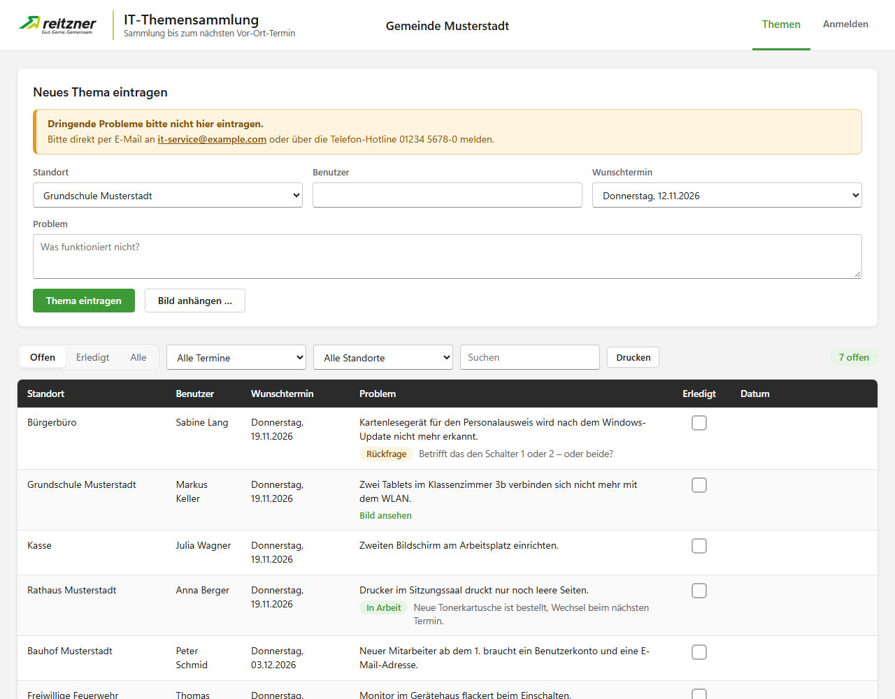
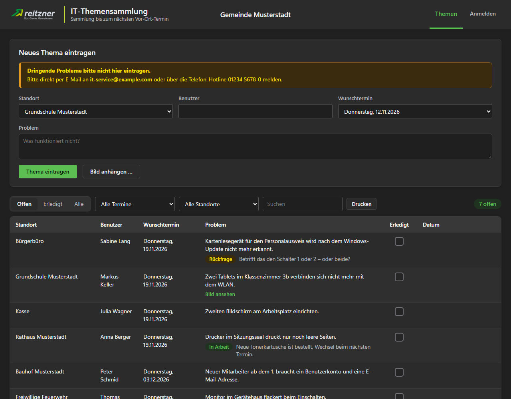
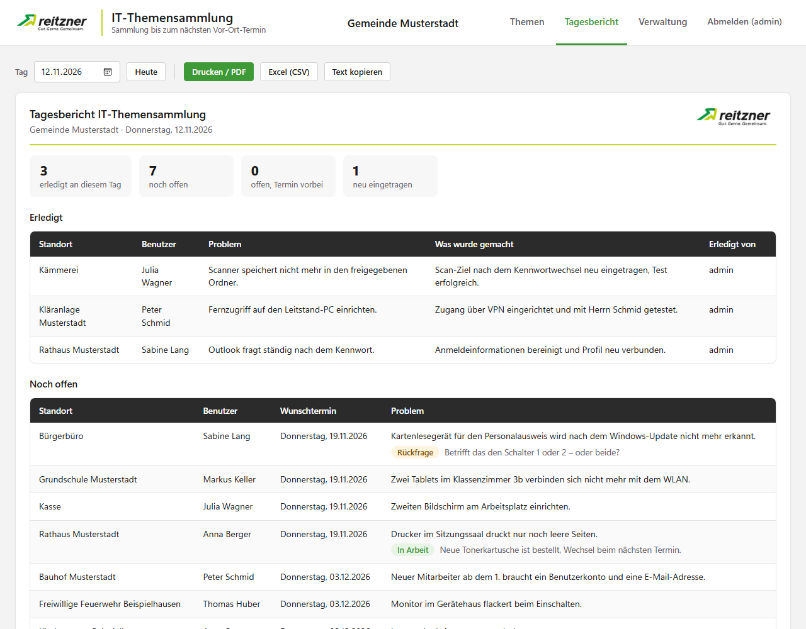
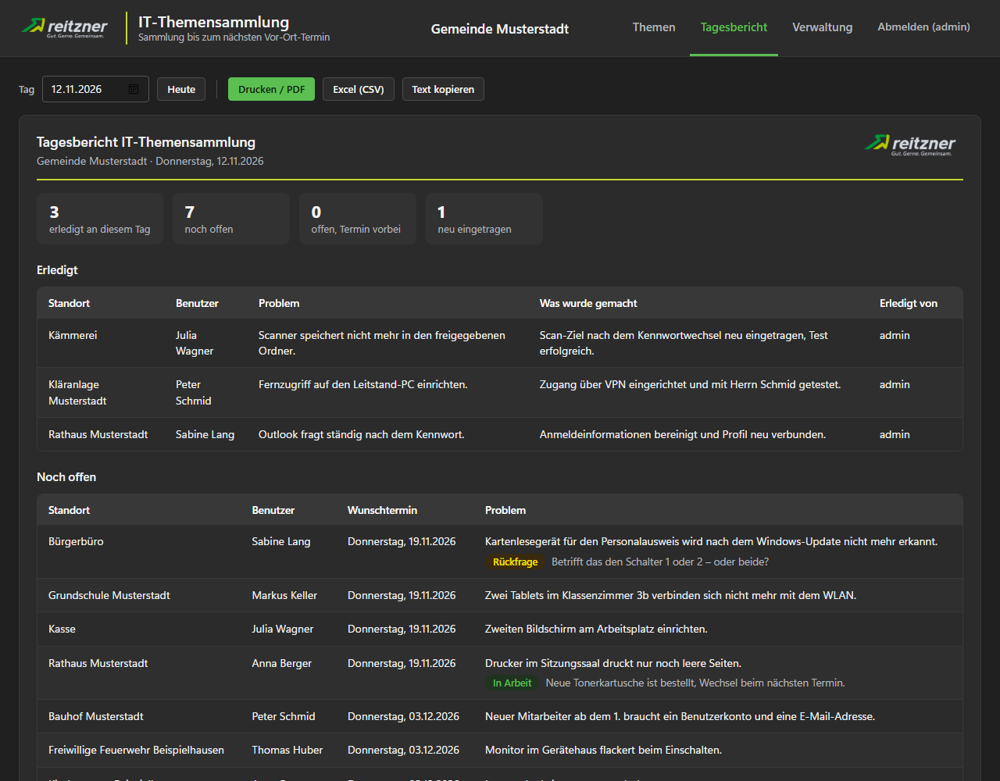
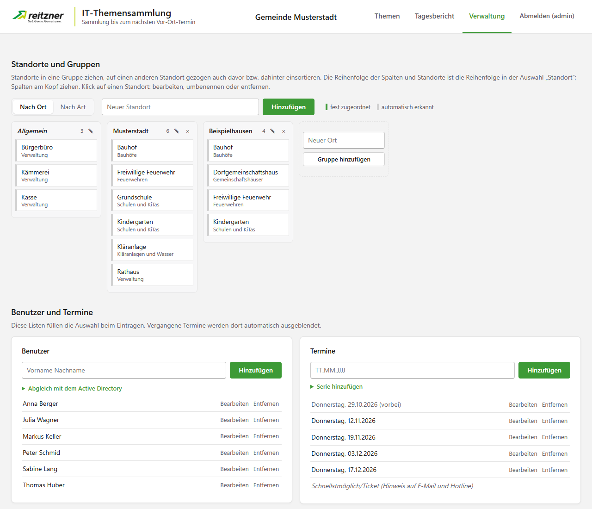
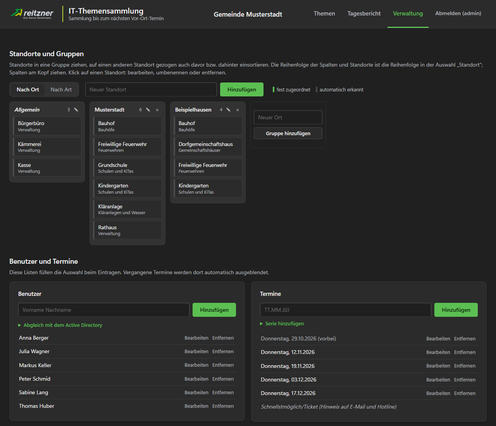
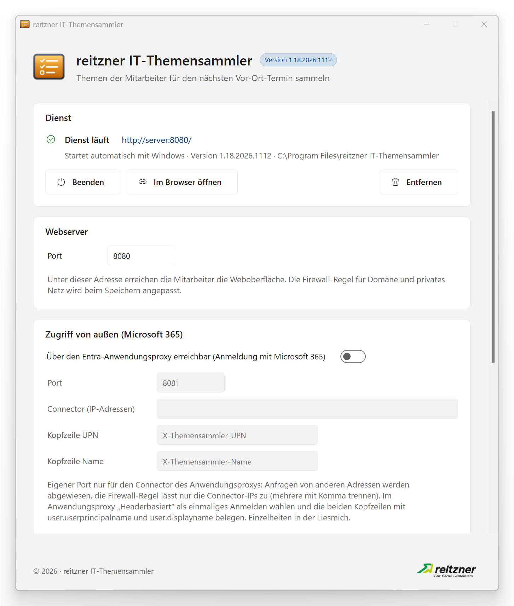
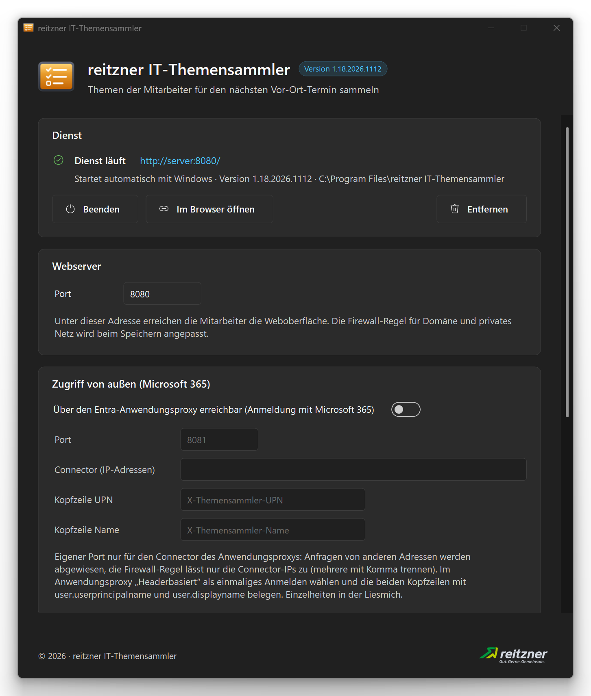
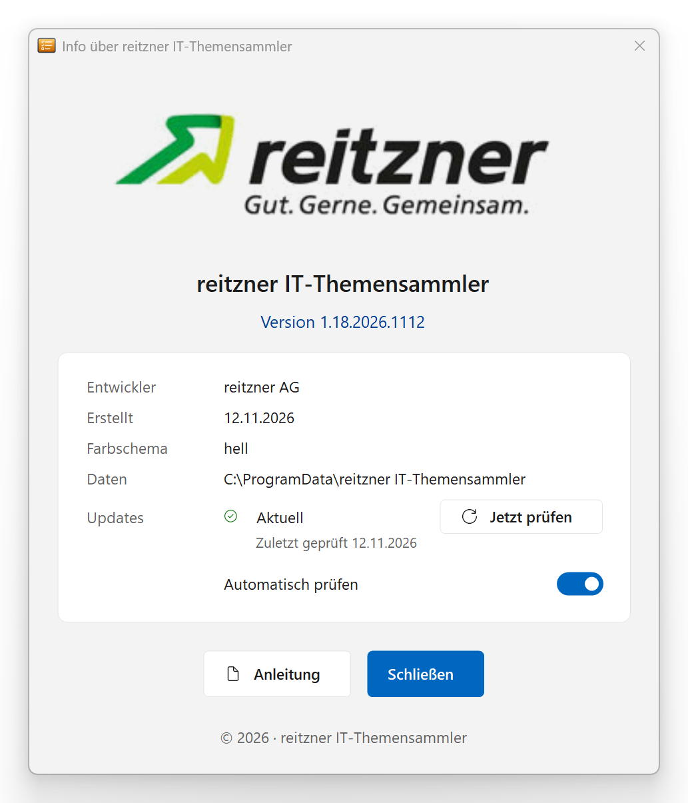
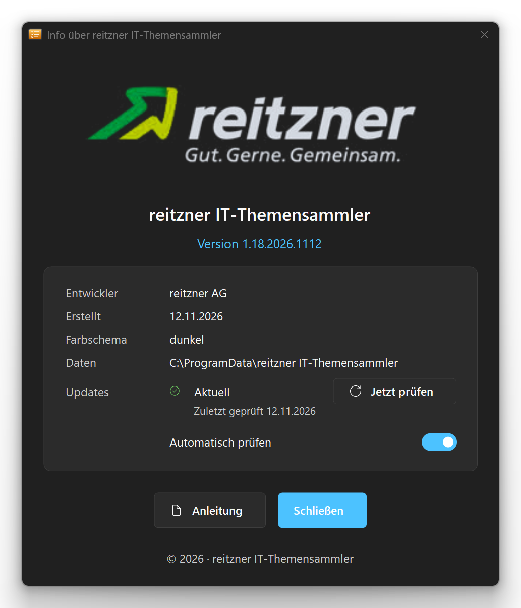

# reitzner IT-Themensammler

**[English](#english) · [Deutsch](#deutsch)**

<table>
  <tr>
    <td></td>
    <td></td>
  </tr>
  <tr>
    <td align="center">Light · Hell</td>
    <td align="center">Dark · Dunkel</td>
  </tr>
</table>

More screenshots · Weitere Screenshots

<table>
  <tr>
    <td></td>
    <td></td>
  </tr>
  <tr>
    <td align="center">Daily report · Tagesbericht</td>
    <td align="center">Daily report · Tagesbericht</td>
  </tr>
</table>

<table>
  <tr>
    <td></td>
    <td></td>
  </tr>
  <tr>
    <td align="center">Administration · Verwaltung</td>
    <td align="center">Administration · Verwaltung</td>
  </tr>
</table>

<table>
  <tr>
    <td></td>
    <td></td>
  </tr>
  <tr>
    <td align="center">Management window · Verwaltungsfenster</td>
    <td align="center">Management window · Verwaltungsfenster</td>
  </tr>
</table>

<table>
  <tr>
    <td></td>
    <td></td>
  </tr>
  <tr>
    <td align="center">About · Info</td>
    <td align="center">About · Info</td>
  </tr>
</table>

The screenshots show made-up sample data and are created automatically when building (`"reitzner IT-Themensammler.exe" --screenshots`). · Die Screenshots zeigen erfundene Beispieldaten. Sie entstehen automatisch beim Erstellen.

Author / Autor: Günther Schoder · [www.westmc002.de](https://www.westmc002.de)

---

## English

Collects the IT topics of a customer's staff until the IT service provider's next on-site visit – instead of notes, e-mails and an Excel list.
A Windows service with a built-in web server: staff enter their topics in the browser, the technician works through them on site and creates the daily report.
Web interface and management window in Windows 11 style (light and dark). The user interface is in German.

### Features

- **Enter topics** – location, name, preferred date and description, without sign-in or with the Windows account; location and name are suggested next time. Urgent problems point to the provider's e-mail and hotline
- **Own topics** – staff can edit and delete their own topics while they are open
- **Status and screenshot** – "in progress" or a question back to the employee with a note; attach a picture (file or pasted screenshot), re-encoded on the server without metadata
- **Complete and report** – close topics with "what was done"; daily summary for printing, as PDF, CSV or text
- **Locations and groups** – selection grouped by place or type, recently used on top; managed on a drag-and-drop board with rename and merge (topics included)
- **Sign-in** – admins with local accounts (PBKDF2 passwords, lockout after failed attempts); staff optionally signed in silently with their domain account (Kerberos/NTLM); from outside with Microsoft 365 via Microsoft Entra application proxy (header-based single sign-on)
- **Active Directory** – take the user list from selected OUs and synchronise it daily, with exclusion rules; suggest the location from the AD field "office" or "department"
- **Per customer** – heading, customer logo (light and dark), e-mail and hotline for urgent problems, whether staff see completed topics, retention period for completed topics (delete, optionally archive as CSV)
- **Windows service** – starts with Windows, restarts on failure, firewall rule; set up, update and remove in the management window
- **Monitoring** – `/api/status` for monitoring tools, Windows event log entries, log file and daily backup of the data
- **Updates** – checks GitHub for a new version at most once a day; "Jetzt aktualisieren" updates program and service
- **Import** – topics and master data from the previous Excel list

### Installation

1. Download `reitzner-IT-Themensammler-<version>.zip` from the [Releases](https://github.com/WestMc002/reitzner-IT-Themensammler/releases).
2. Unzip it into a folder of its own and start `reitzner IT-Themensammler.exe` (asks for administrator rights).
3. In the management window check the port, click "Dienst einrichten" (set up service) and create an admin account.
4. Open the address (e.g. `http://server:8080`) in the browser, sign in as admin and add locations, users and dates under "Verwaltung".

Requirements: Windows 10/11 or Windows Server with .NET Framework 4.x.
The service copies itself to `C:\Program Files\reitzner IT-Themensammler`; the data is stored in `C:\ProgramData\reitzner IT-Themensammler` (readable by administrators and SYSTEM only).

### Building from source

Run `Erstellen.bat`. It uses the C# compiler of the .NET Framework 4 that comes with Windows – no Visual Studio needed.
The version (major.minor.year.monthday) is counted up automatically and the previous EXE is backed up to `Backup`; on request the screenshots are recreated (needs Microsoft Edge or Google Chrome).

## Deutsch

Sammelt die IT-Themen der Mitarbeiter bis zum nächsten Vor-Ort-Termin des IT-Dienstleisters – statt Zetteln, E-Mails und einer Excel-Liste.
Ein Windows-Dienst mit eingebautem Webserver: Die Mitarbeiter tragen ihre Themen im Browser ein, der Techniker arbeitet sie beim Termin ab und erstellt den Tagesbericht.
Weboberfläche und Verwaltungsfenster im Design von Windows 11 (hell und dunkel).

### Funktionen

- **Themen eintragen** – Standort, Name, Wunschtermin und Beschreibung, ohne Anmeldung oder mit dem Windows-Konto; Standort und Name werden für das nächste Mal vorgeschlagen. Dringende Probleme verweisen auf E-Mail und Hotline des Dienstleisters
- **Eigene Themen** – Mitarbeiter bearbeiten und löschen ihre eigenen Themen, solange sie offen sind
- **Stand und Bild** – „In Arbeit“ oder Rückfrage an den Mitarbeiter mit Hinweis; Bild anhängen (Datei oder eingefügtes Bildschirmfoto), auf dem Server ohne Metadaten neu gespeichert
- **Erledigen und Tagesbericht** – Themen mit „Was wurde gemacht?“ abschließen; Zusammenfassung des Tages zum Drucken, als PDF, CSV oder Text
- **Standorte und Gruppen** – Auswahl nach Ort oder Art gruppiert, „Zuletzt verwendet“ oben; in der Verwaltung als Tafel mit Drag and Drop, Umbenennen und Zusammenführen (auch in den Themen)
- **Anmeldung** – Admins mit lokalem Konto (Kennwörter mit PBKDF2, Sperre nach Fehlversuchen); Mitarbeiter wahlweise still mit dem Domänenkonto (Kerberos/NTLM); von außen mit Microsoft 365 über den Entra-Anwendungsproxy (headerbasiertes einmaliges Anmelden)
- **Active Directory** – Benutzerliste aus gewählten OUs übernehmen und täglich abgleichen, mit Ausschlussregeln; Standort aus dem AD-Feld „Büro“ oder „Abteilung“ vorschlagen
- **Anpassbar je Kunde** – Überschrift, Kundenlogo (hell und dunkel), E-Mail und Hotline für dringende Probleme, ob Mitarbeiter erledigte Themen sehen, Löschfrist für erledigte Themen (löschen, auf Wunsch vorher als CSV archivieren)
- **Windows-Dienst** – startet mit Windows, Neustart bei Ausfall, Firewall-Regel; einrichten, aktualisieren und entfernen im Verwaltungsfenster
- **Überwachung** – `/api/status` für das Überwachungsprogramm, Einträge in der Ereignisanzeige, Protokoll und tägliche Sicherung der Daten
- **Updates** – sucht höchstens einmal täglich auf GitHub nach einer neuen Version; „Jetzt aktualisieren“ aktualisiert Programm und Dienst
- **Übernahme** – Themen und Stammdaten aus der bisherigen Excel-Liste

### Installation

1. `reitzner-IT-Themensammler-<Version>.zip` aus den [Releases](https://github.com/WestMc002/reitzner-IT-Themensammler/releases) herunterladen.
2. In einen eigenen Ordner entpacken und `reitzner IT-Themensammler.exe` starten (fragt nach Administratorrechten).
3. Im Verwaltungsfenster den Port prüfen, „Dienst einrichten“ klicken und ein Admin-Konto anlegen.
4. Die Adresse (z. B. `http://server:8080`) im Browser öffnen, als Admin anmelden und unter „Verwaltung“ Standorte, Benutzer und Termine anlegen.

Voraussetzungen: Windows 10/11 oder Windows Server mit .NET Framework 4.x.
Der Dienst kopiert sich nach `C:\Program Files\reitzner IT-Themensammler`; die Daten liegen unter `C:\ProgramData\reitzner IT-Themensammler` (nur für Administratoren und SYSTEM lesbar).
Einzelheiten zu Domänen-Anmeldung, Active Directory, Überwachung und Updates stehen in der `Liesmich.txt`.

### Selbst kompilieren

`Erstellen.bat` ausführen. Sie nutzt den C#-Compiler aus dem .NET Framework 4, der bei Windows dabei ist – ein Visual Studio ist nicht nötig.
Die Version (Haupt.Neben.Jahr.MonatTag) wird dabei automatisch hochgezählt, die bisherige EXE wird unter `Backup` gesichert; auf Nachfrage werden die Screenshots neu erstellt (dafür wird Microsoft Edge oder Google Chrome gebraucht).

## Project structure / Projektaufbau

| Path · Pfad | Content · Inhalt |
|---|---|
| `Quellcode` | C# source (WinForms, Windows service, web server, .NET Framework 4) and `app.manifest` · C#-Quelldateien (WinForms, Windows-Dienst, Webserver) und `app.manifest` |
| `Resources` | icon, reitzner logo, sample data `Demo.json` for the screenshots and the web interface `Web`, embedded into the EXE · Icon, reitzner-Logo, Beispieldaten `Demo.json` für die Screenshots und die Weboberfläche `Web`, in die EXE eingebettet |
| `Screenshots` | images for this page (sample data) · Bilder für diese Seite (Beispieldaten) |
| `Erstellen.bat` | build script · Build-Skript |
| `Liesmich.txt` | manual and version history (German) · Anleitung und Versionsgeschichte (Deutsch) |

## License / Lizenz

GNU General Public License v3.0 or later · GNU General Public License v3.0 oder später – [LICENSE](LICENSE).

© 2026 Günther Schoder

**Exception / Ausnahme:** The reitzner logo (`Resources/Logo-hell.png`, `Resources/Logo-dunkel.png`) is a trademark of reitzner AG and excluded from the GPL. All rights reserved; it may only be redistributed unchanged together with this program. · Das reitzner-Logo (`Resources/Logo-hell.png`, `Resources/Logo-dunkel.png`) ist eine Marke der reitzner AG und von der GPL ausgenommen. Alle Rechte vorbehalten; es darf nur zusammen mit diesem Programm in unveränderter Form weitergegeben werden.

Windows, Active Directory, Microsoft 365 and Microsoft Entra are trademarks of Microsoft Corporation. This project is not affiliated with or endorsed by Microsoft. · Windows, Active Directory, Microsoft 365 und Microsoft Entra sind Marken der Microsoft Corporation. Dieses Projekt ist nicht mit Microsoft verbunden und wird nicht von Microsoft unterstützt.